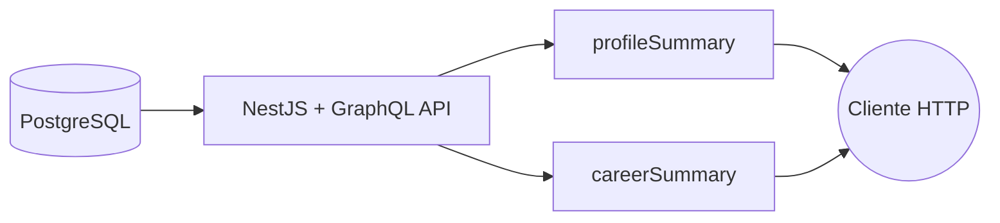

# Carolina Journey

[](https://github.com/cvaldrighi/carolina-journey/actions/workflows/ci.yml)

Arquitetura em camadas que expõe minha trajetória profissional (perfil, experiências, skills, formação e hobbies) através de:

- **PostgreSQL**: camada de dados
- **NestJS + GraphQL (Apollo)**: camada de domínio
- **Functions HTTP (Google Cloud Functions Gen2 / functions-framework)**: camada de apresentação/transformação

Todo o ambiente roda localmente com **um único comando**, via Docker Compose.

---

## Rodando em 1 minuto

**Pré-requisito:** Docker (Docker Desktop, OrbStack, Colima ou Docker Engine no Linux).

```bash
git clone https://github.com/cvaldrighi/carolina-journey.git
cd carolina-journey
docker compose up -d --build
```

Isso sobe o Postgres, aplica o schema e o seed, e inicia a API GraphQL e as duas functions.

| Serviço | URL |
|---|---|
| API GraphQL + Apollo Sandbox | http://localhost:8080/graphql |
| Function `profileSummary` | http://localhost:8081 |
| Function `careerSummary` | http://localhost:8082 |
| PostgreSQL | `localhost:5433` (user `carol` / senha `carol` / db `carolina_journey`) |

Para conferir se está tudo de pé:

```bash
./scripts/smoke-test.sh
```

Para derrubar o ambiente (`-v` também apaga os dados do banco):

```bash
docker compose down -v
```

---

## Experimentando

Abra http://localhost:8080/graphql no navegador e rode, por exemplo:

```graphql
query {
  experiences {
    company
    jobTitle
    startDate
    endDate
    skills { name category }
    highlights { description }
  }
}
```

Ou chame as functions, que consomem a API e devolvem os dados já agregados:

```bash
curl http://localhost:8081   # perfil + idade calculada + hobbies
curl http://localhost:8082   # experiências ordenadas, com skills e highlights
```

---

## Arquitetura



- A API GraphQL centraliza todo o acesso aos dados.
- As functions consomem a API via HTTP e retornam respostas agregadas e formatadas.
- As functions **não acessam o banco diretamente**.

Essa separação entre dados, domínio e apresentação permite escalar e evoluir cada camada de forma independente. É um padrão aplicável a APIs públicas desacopladas, BFFs, microsserviços de consulta e camadas intermediárias entre banco e frontend.

---

## Stack

**Backend:** Node.js 22, TypeScript, NestJS, GraphQL (Apollo), PostgreSQL

**Qualidade:** Jest (testes unitários + E2E), seed idempotente, CI no GitHub Actions

**Infra:** Docker multi-stage, Docker Compose, Google Cloud Run, Cloud Functions Gen2, Supabase

---

## Integração contínua

A cada push, o [GitHub Actions](.github/workflows/ci.yml):

1. Builda a API, sobe um Postgres, roda o seed e executa os testes **unitários e E2E**
2. Builda as duas functions
3. Sobe o **ambiente completo via Docker Compose** e valida os endpoints com o [smoke test](scripts/smoke-test.sh)

---

## Deploy em nuvem (Google Cloud)

O projeto foi publicado no Google Cloud com a seguinte topologia:

```
Supabase (PostgreSQL gerenciado)
        ↓
Cloud Run (NestJS + GraphQL API)
        ↓
Cloud Functions Gen2 (endpoints HTTP formatados)
```

Os endpoints públicos estão **desativados** no momento. A configuração de deploy continua documentada para referência:

- API no Cloud Run: [`graphql-api/README.md`](graphql-api/README.md#deploy-no-cloud-run)
- Functions: [`functions/README.md`](functions/README.md#deploy-no-google-cloud)

---

## Estrutura

```text
.
├── docker-compose.yml        # ambiente completo (postgres + seed + api + functions)
├── graphql-api/              # API NestJS + GraphQL
│   └── src/database/seed/    # schema.sql + seed.sql (idempotentes)
├── functions/
│   ├── Dockerfile            # imagem compartilhada pelas functions
│   ├── profile-summary/
│   └── career-summary/
├── scripts/smoke-test.sh     # validação ponta a ponta dos endpoints
└── .github/workflows/ci.yml
```

Detalhes de desenvolvimento de cada parte estão nos READMEs internos: [`graphql-api`](graphql-api/README.md) e [`functions`](functions/README.md).
